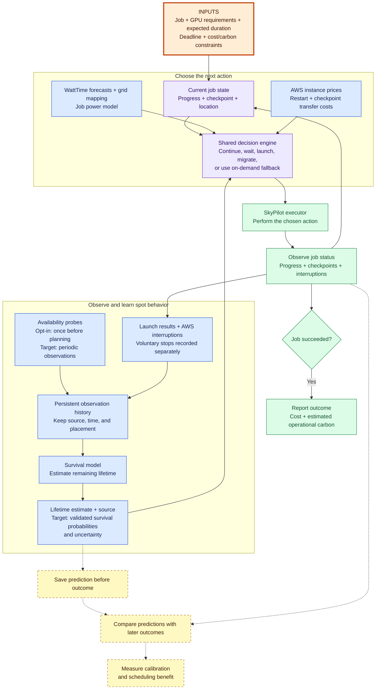

# CarbonSight — notes on how this thing actually works

I’m writing this for Future Me (and anyone else on the repo) so I don’t have to re-derive the whole pipeline every time I touch the code. If I change the estimator, CLI, or folder layout, I should update this file too.

---

## What this project is trying to do

Cloud ML training burns electricity. That electricity comes from a **regional grid**, and grids are not equal — some hours you’re mostly wind/solar/hydro, some hours you’re leaning on gas or coal. CarbonSight’s job is basically: **given a job spec (GPU type, how long you think it’ll run, etc.), rank AWS regions by estimated CO₂** and optionally **patch a SkyPilot YAML and launch**.

It is **not** carbon removal, offsets, or a certified LCA. It’s a **rough IT operational estimate** using WattTime’s **MOER** data plus our own **power model**. Cooling, electrical losses, and other facility overhead are excluded because we do not have facility measurements. Good enough to compare regions and reason about tradeoffs; not something I’d put in a compliance report without more work.

---

## Where stuff lives

All the real Python is under **`carbonsight/`** (that’s where `pyproject.toml` is).

```
carbonsight/
  apps/cli/carbonsight_cli/     # Typer: advise, run, mappings, backtest
  apps/api/carbonsight_api/     # FastAPI if we want HTTP
  packages/core/carbonsight_core/   # Brain — WattTime, registry, math, cloud adapters
    cloud/                      # Provider Protocols; AWS base, GPU catalog, live pricing, preflight
  tests/
  infra/                        # SQL schemas; Postgres not fully wired yet (spot history uses local SQLite, not Postgres)
```

Rule I use: if it’s **domain logic** (how CO₂ is computed, how WattTime is called), it goes in **`carbonsight_core`**. If it’s **parsing flags, printing tables, or HTTP**, it’s **`cli`** or **`api`**. Keeps the core testable without spinning up a server.

---

## Mental model: what talks to what

You give it a **YAML** (SkyPilot-style) and **WattTime credentials**. We also load **`seed_registry.json`** — that’s the hand-maintained map from “AWS `eu-west-1`” to “which WattTime grid code(s)” and weights if it’s a mixture.

Flow that’s in my head:

- **Registry** answers: *which grid(s) does this datacenter sit on?*
- **WattTime** answers: *how dirty is a marginal MWh on that grid right now (forecast) or in the past (historical)?*
- **Power model** answers: *how many watts is this job probably drawing?* (we don’t know utilization, so we randomize — more on that below)
- **carbon_model** multiplies energy × MOER, converts units, runs Monte Carlo for a range

Optional: **boto** checks account-enabled regions (`describe_regions`), GPU quotas (spot or on-demand quota family matching the launch), and **instance type offerings** before `run` so we don’t recommend a region you can’t launch in. Live spot/on-demand pricing and preflight (quota, availability, enabled-regions) share **`BaseAWSProvider`** (`cloud/aws/base.py`) for session/client setup. Offerings use `ec2:DescribeInstanceTypeOfferings`; enabled regions use one `ec2:DescribeRegions` intersected with the registry (run preflight only). **SkyPilot** is what actually provisions the box and runs the `run:` block — we just shell out to `sky launch` / `sky jobs launch` with a patched YAML.

---

## Target system: observations, decisions, and execution

This diagram describes the intended system. Solid arrows show the main data flow; dashed arrows mark feedback paths still to build. Orange marks **INPUTS**, blue marks observation and estimation, purple marks planning, green marks execution, and yellow marks validation that is not yet implemented.



**One decision engine.** Initial planning chooses the first action; dynamic scheduling calls the same decision logic with updated state. A forecast horizon is how far the planner looks ahead, not a fixed itinerary it must store or execute. The target loop refreshes inputs periodically and after meaningful events, and changes placement only when the expected benefit justifies restart and transfer overhead. The current loop only re-decides when idle; it does not migrate a healthy job or refresh forecasts during execution. Progress is elapsed runtime rather than training steps, so observed job success must remain distinct from estimated work completed.

**The survival model exists; validated confidence does not yet.** `planning/survival.py` implements `NelsonAalenModel`, `VirtualInstanceTracker`, observation replay, and a volatility adjustment. A hybrid prior uses pooled observation history and Spot Instance Advisor bands as relative regional weights; with sparse data it uses a Gamma-exponential estimate, switching to Nelson–Aalen after five recorded interruption events per tracker. The no-history baseline is an assumed four-hour mean, not a measured AWS lifetime. These mechanics have unit tests in `tests/unit/test_planner_survival.py`; that is not evidence of real-world prediction accuracy. Probe-derived availability streaks are proxies for instance lifetimes, and voluntary stops provide lower bounds rather than interruption events.

**Validation is a separate target.** Save each prediction, its observation time, input provenance, and placement before seeing the outcome. Compare predicted survival with later observations while accounting for incomplete lifetimes. Measure both calibration (whether predicted probabilities match observed frequencies) and completed-job cost, estimated carbon, and deadline outcomes against a simpler policy. This prediction logging and evaluation loop is not implemented yet.

---

## `advise` — what I’d tell someone who’s never read the code

1. Parse the YAML into a **`JobSpec`** (GPU, count, duration, cpus, memory).
2. Load the registry JSON.
3. Build an **`AwsRegionRankingService`** (registry + **`WattTimeClient`**). For each AWS region with a WattTime mapping it computes **`mapping_confidence`**, then **`JobCarbonEstimator.estimate_region`** → predicted kg CO₂ + rough USD cost. CLI and API both use the same service class.
4. Sort by **lowest CO₂ first** (greenest at top).
5. Apply **`--max-cost-premium`** — default is 0.2, meaning “only show me regions that aren’t more than ~20% pricier than the cheapest option in our table.” Stops the table from being dominated by ultra-green but absurdly expensive regions unless I widen the premium.
6. Print the Rich table or `--json`.

Implementation: `carbonsight/apps/cli/carbonsight_cli/commands/advise.py`.

---

## `train` — same as advise/run, but YAML is generated from a script path

**`carbonsight train train.py`** builds a **temporary SkyPilot YAML** (default resources + `run: python path/to/train.py` relative to cwd), then runs the same **`run_advise`** path as **`advise`**. With **`--launch`**, it uses **`run_launch`** like **`run`**. No change to the estimator—only how the job spec is authored.

Implementation: `carbonsight/apps/cli/carbonsight_cli/commands/train.py`.

---

## `plan-static` — experimental one-shot advice only

**`carbonsight plan-static --yaml train.yaml --finish-by ...`** enumerates forecasted
region × start-time × spot/on-demand candidates and prints the best feasible candidate.
It is an experimental advisory command: it does **not** patch YAML, wait for the selected
start, or launch SkyPilot. The deadline can also come from `carbonsight.finish_by` in YAML.

Implementation: `carbonsight/apps/cli/carbonsight_cli/commands/plan_static.py` and
`carbonsight_core/planning/static.py`.

---

## `run` — same ranking, then actually launch

Same loop as advise, plus optional **quota check** and **instance offerings check** per region (when preflight is enabled). Pick the **greenest** row that still passes the cost filter, **inject `resources.infra` (`cloud/region`) into the YAML** (and strip legacy `cloud`/`region`/`zone` keys), **strip CarbonSight-only keys** (`duration`, `carbonsight`) so SkyPilot only sees valid task fields, write a temp file, call SkyPilot.

### One YAML file (CarbonSight + SkyPilot)

You can keep planning inputs in the same task YAML as SkyPilot. CarbonSight reads them, then removes them before launch:

```yaml
duration: 30m                    # work estimate (CarbonSight only)
carbonsight:
  finish_by: "2026-09-08T22:00:00Z"   # deadline → dynamic planner
  carbon_budget_kg: 10.0               # optional hard cap
  carbon_price: 5.0                    # optional shadow price (USD/kg)

resources:
  accelerators: T4:1
run: |
  python train.py
```

**CLI precedence:** `--finish-by`, `--carbon-budget`, and `--carbon-price` override YAML **only when you pass them**. Omit the flags to use YAML values. GPU utilization is **CLI-only** (`--gpu-util` or `--nvidia-smi`), not a YAML field.

Example: [`examples/skypilot/train.yaml`](../examples/skypilot/train.yaml).

`duration` is an optional runtime estimate. If omitted, the shared estimator uses
one hour as a comparison window and labels this in result notes; it does not predict
job length. CLI output warns that these are hourly comparisons. Unknown-runtime
launches skip job-total ledger estimates. Deadline and delayed-start planning require
an explicit positive duration. The live deadline loop requires observed SkyPilot
success and continues monitoring beyond the estimated duration, up to the deadline.
See [research references](papers/README.md) for the distinction between SkyPilot's
optional estimator and the runtime assumptions in the scheduling papers.

### Dynamic planner (`finish_by`)

When `carbonsight.finish_by` is set (or `--finish-by`), `run` first prints an advisory simulation (**`planning/plan_dynamic_job`**: greedy spot + idle/wait + Safety Net on-demand fallback against the deadline). A real launch then runs a **monitored event loop** in `run.py` driving **`planning/DynamicJob`**: it launches the chosen region/mode with unmanaged, detached `sky launch`, polls the job (`--poll-seconds`), and after an observed preemption or failed launch re-decides and relaunches (checkpoint resume via the existing shim). Waiting for a greener window uses `--idle-tick-hours`. Cost and carbon in the printed trajectory are estimates; a job still running at the deadline is left up (the CLI prints `sky down <cluster>`). `--dry-run`, `--no-exec`, `--validate-sky` and `--sky-smoke` do not start the loop.

**Spot lifetime prior (honesty).** The planner needs an expected spot lifetime per region. The baseline (`ASSUMED_SPOT_MEAN_LIFETIME_HOURS`, 4h) is a placeholder, **not** AWS data. The CLI labels whether estimates come from assumptions, pooled history, or regional history, and whether Advisor bands influence the prior. Preemptions in the advisory simulation are labeled "simulated preemption" and are never recorded. Real observations accumulate in a local SQLite table (`spot_observations`, default `~/.carbonsight/runs.db`, override `--db` / `CARBONSIGHT_DB`; module `carbonsight_core/spot_history.py`, no auth beyond a stub `StoreAuthenticator`): spot launch results (`launch`), observed preemptions (`preemption`) and probes (`probe`). On the next run that history is replayed into the survival model (`planning/survival.py`); a streak is closed as right-censored, not chained, when the run changes or an optional max gap is exceeded. Lifetime buckets default to 0.25h; that resolution does not establish the precision of sparse observations. Confirmed capacity failures count as unavailable. Earlier versions also recorded other launch errors as unavailable, so historical observations may include configuration failures.

Planning combines grid mixtures only at timestamps with finite forecast values for every contributing grid. Regions with no shared timestamps are excluded from forecast planning.

The Nelson–Aalen lifetime estimate integrates conditional survival over intervals measured in hours. Beyond the largest observed age it uses the assumed exponential tail with a four-hour mean, adjusted by the existing volatility factor. With no history, the exponential assumption gives the same remaining lifetime at any current age. This tail is an assumption that affects the scheduler's lifetime estimate.


**Spot Advisor weights (always on, no flag).** With a deadline, the CLI fetches the AWS Spot Instance Advisor bands once at startup (`cloud/aws/spot_advisor.py`), before the advisory simulation, and shares them with the simulation and the real loop. The bands (<5%, 5-10%, 10-15%, 15-20%, >20% interruption frequency, trailing 30 days, regional) come from an **undocumented JSON file** and are coarse, so they are used **only as relative regional weights** (`ADVISOR_BAND_WEIGHTS`, normalized to mean 1), never converted into hours of lifetime. The absolute level comes from our own data: a Gamma–exponential posterior `(1 + d) / (1/λ_prior + E)` with `λ_prior = pooled_scale x regional_weight` and a pooled scale seeded at the assumed 4h (`d` = observed preemptions, `E` = exposure hours including censored and open streaks; the pooled scale also uses the region's own data, so it is a rough empirical-Bayes estimate). Once a region has `MIN_EVENTS_FOR_NELSON_AALEN` (5) observed preemptions it switches to the Nelson–Aalen model. Most GPU instance types sit in the >20% band in every region, in which case the weights are equal and the result is the flat prior plus our data. If the fetch fails the run warns and falls back to the flat assumed prior. The band seen at observation time is stored in `spot_observations.advisor_band` so the weights can be checked or dropped later. Prior labels name the tier (for example `history: 2 events, 5.0h exposure x advisor band >20%`, `pooled history (3 events) x advisor band 5-10%`).

**Pre-plan probe (`--probe/--no-probe`, default off).** With `--probe`, a deadline and a real Spot-enabled launch, the CLI runs one probe per candidate region against AWS once, just before `plan_dynamic_job`. The results go into the same history as stored observations and are saved with the advisor band, so the simulation and the real loop both see them. One probe is only a snapshot (capacity existed or not at that moment), so it moves the prior a little at most; this is the only probe; there is no interval probing.

**Probe details.** `cloud/aws/probe.py` launches one Spot instance of the catalog type per candidate region and terminates it right away (the SkyNomad paper's availability probe). **It bills real GPU instances and needs vCPU quota**; it needs `ec2:RunInstances`/`TerminateInstances` and `ssm:GetParameter`, and uses the default VPC. Only conclusive results are recorded (capacity error = unavailable; quota, auth or throttling errors are logged and skipped). A probe only says capacity existed at that moment, not how long an instance would live. For jobs specifying an exact EC2 instance type, the CLI can query free regional Spot placement scores for the requested node count. Among regions within the cost ceiling, a higher score breaks ties in estimated emissions. Missing scores leave emissions as the primary ordering signal. Scores describe launch likelihood and stay out of the lifetime model. Error codes and AMI/VPC assumptions in the probe have not been verified on a real account.

Without `finish_by`, `run` uses the immediate greenest-region ranking. Optional
`--max-delay` start-time advice is printed only: `run` does not wait before launching.
`run` does not call the experimental static planner.

### SkyPilot validation

- **`--dry-run`** — print SkyPilot-ready patched YAML (no launch)
- **`--validate-sky`** — run `sky launch --dryrun` on the patched YAML
- **`--sky-smoke`** — minimal echo job with `sky launch --down` (provision + auto teardown)

If the subprocess exits 0, we try **post-run actual CO₂** via **`JobCarbonEstimator.compute_actual_run`**: pull **historical** MOER for the job window from WattTime, time-weight it, compare to the pre-run estimate. The module-level **`compute_actual_co2`** remains a thin wrapper for tests and scripts. Start/end times are **wall clock around the local SkyPilot process** — MVP scope.

Implementation: `commands/run.py`.

---

## Checkpoint resilience for spot training

When `--spot` (default ON) and `--checkpoint` (default ON), CarbonSight wraps the training command with automatic checkpoint saving and resume. The flow:

1. **Framework detection** (`checkpoint.py`): `ast.parse` scans the user's script for imports — `transformers` → HuggingFace, `lightning`/`pytorch_lightning` → Lightning, `torch` → raw PyTorch.
2. **SkyPilot Storage mount**: persistent cloud storage (auto-managed S3 bucket via SkyPilot's Storage abstraction) is mounted at `/ckpt`. Survives preemption and re-provisioning.
3. **Shim wrapper** (`checkpoint_shim.py`): standalone script uploaded to the remote instance via `file_mounts`. It:
   - Scans `/ckpt` for existing checkpoints and injects `--resume_from_checkpoint` (HF) or `--ckpt_path` (Lightning) on resume
   - Injects framework-specific save args on first run (`--output_dir /ckpt --save_strategy steps --save_steps 500` for HF)
   - Registers a SIGTERM handler that sends SIGINT to the child process (frameworks handle SIGINT for graceful checkpoint save)
   - Waits up to 110s for graceful shutdown before terminating
4. **Managed spot** (`sky jobs launch`): auto-enabled when spot + checkpoint are both on. SkyPilot re-provisions and re-runs after preemption; the shim finds the latest checkpoint and resumes.

The shim is Python 3.8+ compatible with zero external dependencies (it runs on whatever the remote instance has).

Implementation: `carbonsight/packages/core/carbonsight_core/checkpoint.py` (core), `checkpoint_shim.py` (remote shim).

---

## Other entrypoints (short)

- **`train`** — convenience wrapper: script path → temp YAML → advise or run (see above).
- **`mappings validate`** — hits WattTime `region_from_loc` per site, builds mixture-aware `wt_regions`, compares to stored registry; reports **mapping confidence**; `--json` for scripts; **exit 1 on drift** (exit 0 if creds missing). Core: `mapping/validate.py`.
- **`mappings refresh`** — re-resolves WattTime grid codes from site coordinates and updates `wt_regions` in the registry JSON; **dry-run by default**; `--write` persists (use `--out` to avoid overwriting bundled seed).
- **`backtest`** — synthetic MOER/price; tests policy without live API.
- **API** — `POST /v1/mappings/revalidate` runs the same validate core as CLI; run storage is still stubby.

---

## Terms I had to learn (no shame)

**MOER** — “marginal operating emissions rate.” Plain English: *if I use one more MWh of electricity at the margin of this grid, how much extra CO₂?* WattTime gives it in **lb CO₂ per MWh** a lot of the time. We convert to kg with **0.45359237**.

**Why marginal and not annual average?** Because the thing that responds to *your* extra load is usually the marginal generator, not the grid’s year-average mix.

**PUE** — power usage effectiveness: facility power / IT power. CarbonSight does not assume or estimate PUE, because a cloud region can span unknown facilities and we do not have their cooling or facility-energy measurements.

**Mixture** — sometimes one AWS region is modeled as split across two WattTime regions with weights. We take a **weighted average** of MOER, same idea as mixing two signals.

**Forecast vs historical** — before launch we use whatever the API gives us for “near-term” (forecast path in code). After `run`, we can integrate **historical** points over the actual window for a more grounded number.

---

## The math, in words I can explain to my dad

**Core identity:**

> kg CO₂ ≈ (IT MWh over the job) × (MOER in lb/MWh) × (lb → kg)

**IT MWh** isn’t just “GPU nameplate watts × hours.” We model **IT watts** (base + GPU + CPU + mem + small network), then multiply by **duration**. GPU power is interpolated between idle and peak using a **random utilization** each Monte Carlo draw because I don’t know if your training script is pegging the GPU or waiting on I/O. This deliberately excludes cooling and other facility overhead.

**GPU specifications.** Published maximum board power and explicit hardware aliases live in
[`gpu_power_specs.json`](carbonsight/packages/core/carbonsight_core/estimator/gpu_power_specs.json).
Each entry has a manufacturer source link; the catalog records its review date. For example,
L4 uses a 72 W maximum, while AWS A10G uses 300 W. These are hardware envelopes, not
measured training power. The idle floor is explicitly assumed at 10% of that maximum,
and power is interpolated linearly with utilization. Unqualified A100, V100, H100, and
H200 names use the highest cataloged variant envelope; explicit PCIe/SXM/NVL aliases
select their own specifications. Unknown names require a positive, finite per-GPU
`carbonsight.gpu_power_limit_w` in YAML, or `gpu_power_limit_w` in the API request,
instead of receiving generic watts. Result notes identify the limit, source, and model assumptions.

**Keeping specifications current.** Review the linked vendor document when adding or
updating an entry, retain exact variant names, update `reviewed_on`, and run the catalog
checks in `tests/unit/test_gpu_telemetry.py`. New entries and aliases are data-only changes;
there is no network lookup during estimation and no automatic source refresh. This catalog
covers power modeling only: AWS instance selection, quotas, and pricing have separate
catalogs. AWS preflight/probing currently normalizes suffixes to a representative GPU
family, so an explicit power-model variant does not establish matching launch support.

For each region-ranking request, we sample IT power **1000 times** (Monte Carlo) once for the job and reuse those samples across all candidate regions. Each region applies its own MOER, fetched outside the sampling loop. Sort the 1000 kg outcomes → **mean**, **p10**, **p90**. The range reflects the assumed utilization distribution, not validated confidence in actual emissions. GPU utilization is sampled uniformly from 60–90% unless supplied; CPU utilization is sampled uniformly from 40–60%. No normal distribution is imposed.

**Cost** is separate: base $/GPU/hr × regional multiplier × count × hours. With `--spot` (default ON), cost uses either **live EC2 spot history** (when `CARBONSIGHT_LIVE_AWS_PRICING=1` or `--live-pricing`) via `describe_spot_price_history` (min across AZs, cached), or live/static on-demand × `SPOT_PRICE_FRACTION` (0.35) as fallback. With live pricing and `--no-spot`, on-demand cost uses **Pricing API** `get_products` (OnDemand terms only), mapped via `aws_pricing_locations`. Static tables remain the default when live pricing is off. IAM: `ec2:DescribeSpotPriceHistory`, `pricing:GetProducts`. It’s for **relative** ranking vs other regions, not a quote from AWS billing.

**Post-run:** historical MOER gets a **time-weighted** average across the window (WattTime points are ~5 min apart; we clip partial intervals at the edges). Power uses the shared deterministic expected-IT-power function, while the **grid** signal is historical. This remains an estimate, not metered energy.

---

## Where this is weak (I’m not going to pretend)

- **Watts remain modeled.** `--nvidia-smi` supplies utilization, not measured power, and does not validate the assumed idle floor or linear power curve. MOER can be right and kg CO₂ can still be off if utilization is weird.
- **Facility overhead is excluded.** We do not know the PUE, cooling system, or electrical losses of the specific cloud facility serving a job.
- **Pricing** is static on-demand tables by default; optional live on-demand via Pricing API and live spot via EC2 API when `CARBONSIGHT_LIVE_AWS_PRICING=1` or `--live-pricing`.
- **Registry** is human-maintained; wrong WattTime v3 code → wrong grid. `mappings validate` exists for a reason.
- **Post-run timing** is subprocess wall time, not guaranteed cluster semantics for every SkyPilot mode.

---

## If I need to change something — file map

| What I’m touching | File |
|-------------------|------|
| CO₂ math, Monte Carlo, post-run | `carbonsight/packages/core/carbonsight_core/estimator/carbon_model.py` |
| Watt curves, expected and sampled IT power | `.../estimator/power_model.py` |
| $ estimates, spot/on-demand pricing | `.../estimator/pricing.py`, `.../cloud/aws/spot_pricing.py`, `.../cloud/aws/ondemand_pricing.py`, `.../cloud/aws/gpu_catalog.py` |
| AWS shared boto plumbing | `.../cloud/aws/base.py` |
| Mapping drift / refresh | `.../mapping/validate.py`, `.../mapping/refresh.py` |
| Preflight (quota, offerings, enabled regions) | `.../cloud/aws/` (`quota.py`, `availability.py`, `enabled_regions.py`) |
| Region → grid JSON | `.../mapping/seed_registry.json` |
| WattTime client / auth / retries | `.../watttime.py` |
| Time-shift scheduling | `.../scheduler.py` |
| Job planning (static + dynamic, finish-by) | `.../planning/` |
| Persistent run ledger (SQLite) | `.../tracking.py` |
| Checkpoint core (framework detect, YAML patch) | `.../checkpoint.py` |
| Checkpoint shim (remote SIGTERM wrapper) | `.../checkpoint_shim.py` |
| CLI commands | `carbonsight/apps/cli/carbonsight_cli/commands/` |
| API routes | `carbonsight/apps/api/carbonsight_api/routes/` |

---

## Tests

From `carbonsight/`:

```bash
PYTHONPATH=packages/core:apps/cli pytest tests/ -v
```

---

That’s the gist. If this doc and the code disagree, **the code wins** until I fix one of them.
